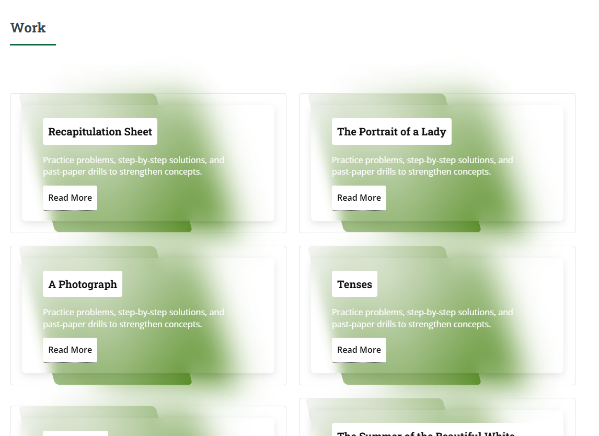

# Notebook Work Library

Notebook Work Library is a student resource website with class-wise subject pages, study materials, question banks, and exam papers.

- **Live website:** [dpsnwl.rf.gd](https://dpsnwl.rf.gd)
- **Website entry point:** [`index.html`](index.html)

## Developer handoff

This repository contains a mostly static website built with HTML, CSS, and JavaScript. There is no root-level package manifest or build configuration. Most pages are individual HTML files, and class-specific resources and assets are kept in the relevant class folders.

### Repository layout

- `index.html` — landing page and links to the class sections
- `1st/`–`12th/` — class pages and, where present, class-specific resources, images, scripts, manifests, and service workers
- `assets/` — shared site assets
- `images/` — images used by the landing page
- `Readme_images/` — screenshots used in this guide

Class folder contents are not uniform. Before adding or linking a page, check the relevant folder and follow its existing naming and asset-path conventions. Some filenames contain spaces; encode spaces as `%20` in Markdown links when needed.

### Preview locally

From the repository root, start a local web server:

```powershell
py -m http.server 8000
```

Open <http://localhost:8000> in your browser. Stop the server with `Ctrl+C`. Using localhost is preferable to opening HTML files directly because service workers and other browser features require an HTTP(S) origin.

### Change and test pages

1. Identify the page and any class-specific assets or scripts it uses.
2. Keep links relative to the page that contains them.
3. Preview each changed page locally on both desktop and a narrow/mobile viewport.
4. Test affected navigation, document downloads, and forms.
5. When changing a service worker or cached assets, verify the update in a clean browser session; an existing service worker may continue to serve cached files.

There is currently no automated build or test command configured at the repository root, so browser checks are the main validation step.

## Page structure

### Google Analytics and Google Tag Manager

The landing page loads Google Analytics and Google Tag Manager in its `<head>`. These scripts do not add visible page content; the configured analytics and tag-manager setup is used for site measurement.

Add the scripts near the start of the `<head>` in pages that need the same tracking. Avoid adding duplicate tracking snippets to a page. The IDs below belong to this site's current configuration; confirm they are still correct before changing them.

```html
<!-- Google tag (gtag.js) -->
<script async src="https://www.googletagmanager.com/gtag/js?id=G-1Z8ES7LDYL"></script>
<script>
  window.dataLayer = window.dataLayer || [];
  function gtag(){dataLayer.push(arguments);}
  gtag('js', new Date());

  gtag('config', 'G-1Z8ES7LDYL');
</script>

<!-- Google Tag Manager -->
<script>
  (function(w,d,s,l,i){w[l]=w[l]||[];w[l].push({'gtm.start':
  new Date().getTime(),event:'gtm.js'});var f=d.getElementsByTagName(s)[0],
  j=d.createElement(s),dl=l!='dataLayer'?'&l='+l:'';j.async=true;j.src=
  'https://www.googletagmanager.com/gtm.js?id='+i+dl;f.parentNode.insertBefore(j,f);
  })(window,document,'script','dataLayer','GTM-597CBPND');
</script>
<!-- End Google Tag Manager -->
```

The companion `<noscript>` block belongs immediately after the opening `<body>` tag, not in the `<head>`:

```html
<!-- Google Tag Manager (noscript) -->
<noscript>
  <iframe src="https://www.googletagmanager.com/ns.html?id=GTM-597CBPND"
    height="0" width="0" style="display:none;visibility:hidden"></iframe>
</noscript>
<!-- End Google Tag Manager (noscript) -->
```

### Main content and section placement

The main page content is nested inside `#wrapper`, `#main`, and `.inner`. The banner is the first section. Add further sections—such as class links, feedback, or recruitment—after the banner and before the closing tags for `.inner` and `#main`.

```html
<div id="wrapper">

				<!-- Main -->
					<div id="main">
						<div class="inner">

							<!-- Header -->
								<header id="header">
								
										
								</header>

							<!-- Banner -->
								<section id="banner">
									<div class="content">
										<header>
											<h1>Welcome to Notebook Work Library</h1><br />
											<h2>by Mohd Hifzaan Khan</h2>
											<p>This website was originally designed for Class 10th students in the 2025-26 academic session. It is currently being updated to serve Class 11th students and the new Class 10th cohort. The platform provides comprehensive question banks, school-conducted papers, and previous year questions aligned with CBSE curriculum standards. The website will be continuously updated with the latest CBSE question banks and examination papers as they are released. The current notebook materials are from the 2025-26 session; however, updates with the latest resources will be implemented promptly. We encourage you to visit regularly for the most recent educational materials and updates.
											</p>
										</header>
										
										<ul class="actions">
											
											<li><a href="https://workhaul.my.canva.site/mhk" class="button big">Go to my old Website</a></li>
										</ul>
									</div>
									
									<span class="image object">
										
									</span>
								</section>

      <!-- Add other sections here, before .inner and #main are closed. -->
    </div>
  </div>
</div>
```
While modifiying the website don't mess with the above lines because they makes the structure and helps other sections also.
The banner appears like this:


### “Choose Your Class” section

This section gives visitors class links using a heading and a set of cards. Add it after the banner, inside `.inner`.

```html
<section>
  <header class="major">
    <h2>Choose Your Class!</h2>                                                                                     ← You can change this heading
  </header>

  <div class="container">
    <div class="box">
      <div class="content">
        <h3><a href="12th/12th Home.html">Class 12th</a></h3>                                                       ← You can change this heading
        <p>Practice problems, step-by-step solutions, and past-paper drills to strengthen concepts.</p>             ← You can change this paragraph
        <a href="12th/12th Home.html" style="box-shadow: none;">Read More</a>                             ← You can change this text of this button and also where its linked to
      </div>
    </div>

    <div class="box">
      <div class="content">
        <h3><a href="11th/11th Home.html">Class 11th</a></h3>
        <p>Practice problems, step-by-step solutions, and past-paper drills to strengthen concepts.</p>
        <a href="11th/11th Home.html" style="box-shadow: none;">Read More</a>
      </div>
    </div>

    <div class="box">
      <div class="content">
        <h3><a href="10th/10thHome.html">Class 10th</a></h3>
        <p>Clear explanations, experiment summaries, and topic question banks for exam prep.</p>
        <a href="10th/10thHome.html" style="box-shadow: none;">Read More</a>
      </div>
    </div>

    <div class="box">
      <div class="content">
        <h3><a href="9th/9thHome.html">Class 9th</a></h3>
        <p>Clear explanations, experiment summaries, and topic question banks for exam prep.</p>
        <a href="9th/9thHome.html" style="box-shadow: none;">Read More</a>
      </div>
    </div>
  </div>
</section>
```

The section heading uses `<header class="major">`. The `.container` holds the cards, and each `.box` is one class card. To add another class, duplicate a complete `.box` and update its title, description, and both links. Before using the code given above make sure to remove the "you can change this or that" directions because if you not it will appear in the output.


### Subject cards

Subject pages use the same card structure as the class section. The heading, destination filenames, and descriptions can change by class or stream.

```html
<section>
  <header class="major">
    <h2>Subjects</h2>                                                                                       ← You can change this heading
  </header>

  <div class="container stream-grid">
    <div class="box">
      <div class="content">
        <h3><a href="Physics.html">Physics</a></h3>                                                         ← You can change this heading
        <p>Practice problems, step-by-step solutions, and past-paper drills to strengthen concepts.</p>      ← You can change this paragrapgh
        <a href="Physics.html" style="box-shadow: none;">Read More</a>                                    ← You can change this text of this button and also where its linked to
      </div>
    </div>

    <div class="box">
      <div class="content">
        <h3><a href="Chemistry.html">Chemistry</a></h3>
        <p>Practice problems, step-by-step solutions, and past-paper drills to strengthen concepts.</p>
        <a href="Chemistry.html" style="box-shadow: none;">Read More</a>
      </div>
    </div>

    <div class="box">
      <div class="content">
        <h3><a href="Biology.html">Biology</a></h3>
        <p>Practice problems, step-by-step solutions, and past-paper drills to strengthen concepts.</p>
        <a href="Biology.html" style="box-shadow: none;">Read More</a>
      </div>
    </div>
  </div>
</section>
```

Use one complete `.box` per subject. To add or remove a subject, duplicate or delete a complete card and update both links and the displayed text. Before using the code given above make sure to remove the "you can change this or that" directions because if you not it will appear in the output.


### Stream cards

Stream pages use the `stream-grid` layout to present each stream as a card. Both links in a card should lead to the selected stream's page.

```html
<section>
  <header class="major">
    <h2>Choose Your Class 11 Stream</h2>                                                                         ← You can change this heading
  </header>

  <div class="container stream-grid">
    <div class="box">
      <div class="content">
        <h3><a href="PCB.html">PCB</a></h3>
        <p>Practice problems, step-by-step solutions, and past-paper drills to strengthen concepts.</p>           ← You can change this paragrapgh
        <a href="PCB.html" style="box-shadow: none;">Read More</a>                                        ← You can change this text of this button and also where its linked to
      </div>
    </div>

    <div class="box">
      <div class="content">
        <h3><a href="Commerce.html">Commerce</a></h3>
        <p>Practice problems, step-by-step solutions, and past-paper drills to strengthen concepts.</p>
        <a href="Commerce.html" style="box-shadow: none;">Read More</a>
      </div>
    </div>
  </div>
</section>
```

Keep the heading and destinations appropriate for the class or stream being presented. Some class pages add `stream-grid` styles in their own `<head>` to control the number of columns. Before using the code given above make sure to remove the "you can change this or that" directions because if you not it will appear in the output.


### Work and PYQ cards

Work and previous-year question (PYQ) pages use the same card structure, but the links point to resource files instead of subject or stream pages.

```html
<section>
  <header class="major">
    <h2>Work</h2>                                                                         ← You can change this heading
  </header>

  <div class="container stream-grid">
    <div class="box">
      <div class="content">
        <h3><a href="PDFs/English/Eng Recap.pdf">Recapitulation Sheet</a></h3>                                     ← You can change this heading
        <p>Practice problems, step-by-step solutions, and past-paper drills to strengthen concepts.</p>           ← You can change this paragrapgh
        <a href="PDFs/English/Eng Recap.pdf" style="box-shadow: none;">Read More</a>                     ← You can change this text of this button and also where its linked to
      </div>
    </div>

    <div class="box">
      <div class="content">
        <h3><a href="PDFs/English/a photograph.pdf">A Photograph</a></h3>
        <p>Practice problems, step-by-step solutions, and past-paper drills to strengthen concepts.</p>
        <a href="PDFs/English/a photograph.pdf" style="box-shadow: none;">Read More</a>
      </div>
    </div>
  </div>
</section>
```
 Before using the code given above make sure to remove the "you can change this or that" directions because if you not it will appear in the output.
To add or remove a resource:

1. Duplicate or delete one complete `.box` card.
2. Change the displayed title.
3. Update both `href` values to the exact relative path of the resource.
4. Keep filename and path case identical to the file on disk.

The same framework applies to PYQ pages. Replace the example paths with the appropriate paper or marking-scheme paths inside `PYQ/`.




### Card checklist

- `h3 > a` is the visible card title and primary link.
- The lower `Read More` link should point to the same destination.
- The `href` path must match the file or page structure from the current folder.
- Each `.box` must remain inside `.container` and the enclosing `<section>`.
- Use an existing layout class such as `stream-grid` instead of adding duplicate card styles.
- Test every link, especially links containing spaces or mixed capitalization.

## Integrations and deployment notes

- The landing page contains analytics/tag-manager setup and a feedback form that submits to an external form service. Confirm these integrations are still intended and available before changing their configuration.
- The landing page also has a recruitment form posting to `/recruitment`. This repository does not include an obvious server application, so confirm that the production host handles this route before relying on the form.
- The landing page references a root-level web app manifest and service worker, but those files are not currently present in the repository root. Check whether they are supplied by the production host or need to be restored; class folders also contain their own PWA files.
- The live site is hosted separately from the source files. Confirm the current hosting account, deployment method, domain/DNS ownership, and any server-side routes with the site owner before publishing or changing production settings.

## Credits

The site uses the Editorial template by [HTML5 UP](https://html5up.net/editorial), licensed under [CC BY 3.0](https://html5up.net/license). Preserve the required attribution when modifying or redistributing the template-based design.
